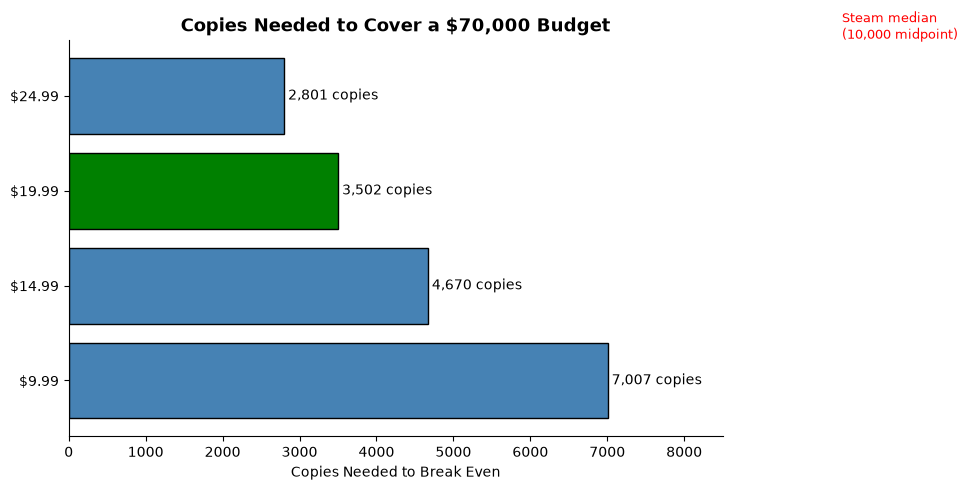
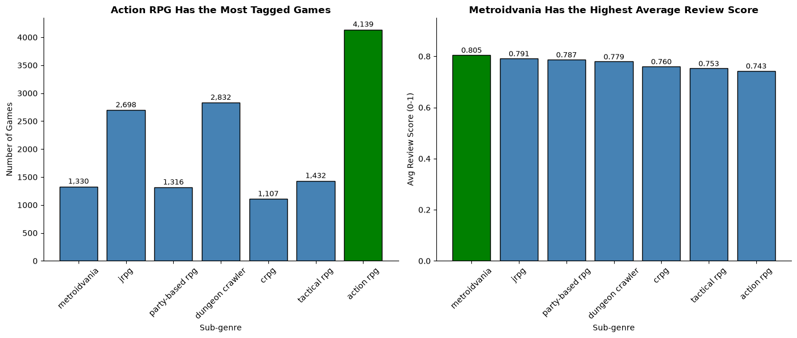

# Steam RPG market analysis

Alejandro Molina

Four friends have a story they want to make into a small Steam RPG. They have a $70,000 budget, they do not want microtransactions, and this notebook is the market check behind that plan.

## Business question

How many copies does a $70,000 RPG need to sell to cover its budget, and which genre tags, languages, and release dates does the Steam catalog support? The notebook also checks whether downloadable content or a recommendations-based visibility cut shows a payoff in this file.

## Key findings

The cleaned file has **100,970** games after **21,641** rows coded `0 - 0` were removed from the original **122,611**. **18,532** of those games have "RPG" in the genre field. The tag, language, DLC, timing, and recommendation cuts below are run on the full cleaned catalog.

1. **A $70,000 budget breaks even at a few thousand full-price copies.** The notebook divides $70,000 by four list prices. That is **7,007** copies at $9.99, **4,670** at $14.99, **3,502** at $19.99, and **2,801** at $24.99. Raising the price from $9.99 to $14.99 lowers the target by 2,337 copies, the next step to $19.99 lowers it by 1,168, and the step to $24.99 lowers it by 701. The red line on the chart is a **10,000** owner-range midpoint. On the seven RPG tags, average list price is about **$6.53 to $7.98**, below every price on this chart.



2. **Action RPG is the largest tag. Metroidvania has the highest average review score. Three other tags sit in a higher owner bucket.** Counts can overlap, because a game can carry more than one of these tags. Action RPG has the highest average estimated revenue, about **$4.26 million**, while its median owner midpoint stays **10,000** and its average price is **$7.98**. That revenue figure is a mean of price times the owner midpoint, so the largest games dominate it.

| Tag | Games | Median owner midpoint | Avg. review score | Avg. price | Avg. estimated revenue |
| --- | ---: | ---: | ---: | ---: | ---: |
| Metroidvania | 1,330 | 10,000 | 0.805 | $6.87 | $793,083 |
| JRPG | 2,698 | 35,000 | 0.791 | $7.39 | $1,130,984 |
| Party-based RPG | 1,316 | 35,000 | 0.787 | $7.83 | $1,124,595 |
| Dungeon crawler | 2,832 | 10,000 | 0.779 | $6.53 | $1,344,111 |
| CRPG | 1,107 | 35,000 | 0.760 | $6.99 | $2,477,955 |
| Tactical RPG | 1,432 | 10,000 | 0.753 | $7.45 | $915,845 |
| Action RPG | 4,139 | 10,000 | 0.743 | $7.98 | $4,258,040 |

Review scores and prices are the notebook's printed means, rounded to three decimals and to the cent. Revenue is the printed mean, rounded to the dollar.



3. **Simplified Chinese is the most common non-English language listing.** The top ten, counting games that list the language, are Simplified Chinese **28,593**, German **25,630**, French **25,327**, Japanese **24,596**, Spanish - Spain **23,560**, Russian **23,462**, Italian **17,086**, Korean **15,664**, Portuguese - Brazil **14,391**, and Traditional Chinese **14,227**. English is excluded from this chart, and its count is not printed.

4. **October, Q4, and Thursday are the most common release slots.** The notebook's printed result is October for month, Q4 (Oct–Dec) for quarter, and Thursday for day of week. The chart shows Saturday and Sunday well below the weekdays. Monthly counts are drawn on the chart and are not printed as a table, so they are not repeated here. This is a count of releases.

5. **DLC does not move the median owner midpoint, and recommendation tier is a poor stand-in for a marketing budget.** Games with DLC and games without it both have a median owner midpoint of **10,000**. Average review score is **0.805880** with DLC and **0.748528** without. On the recommendation chart, the tiers that appear are Medium (100–1K), High (1K–10K), and Very High (10K+), with median owner midpoints of **35,000**, **150,000**, and **1,500,000**, and median review scores of **0.821**, **0.868**, and **0.901**. The Low tier is absent. The trailer column had no usable rows, which is why the notebook used recommendations at all.

## Recommendation

Price the game at **$19.99** if the studio can hold a price above the $6.53–$7.98 tag averages. That price covers the $70,000 budget at **3,502** copies under the notebook's formula, and it is the highlighted bar because the copy-count savings shrink after that step. Treat 3,502 as a floor. The formula gives the studio the entire list price.

Match the game to the story they already have. A Metroidvania with action-RPG combat lines up with the highest-reviewed tag in this set (0.805 on 1,330 games) and with the largest tag (4,139 action RPGs). JRPG, party-based RPG, and CRPG are the tags whose median owner midpoint is 35,000. Choose one of those three when the design already fits that tag.

Ship **English, German, French, and Spanish - Spain**. German, French, and Spanish - Spain are listed on 25,630, 25,327, and 23,560 games. Simplified Chinese is listed on more games (28,593), and Japanese on 24,596. The notebook prefers the three European languages as a translation-effort judgment. That cost is not measured here, so Chinese and Japanese stay a second decision with their own budget.

Launch on a **Thursday in October** when the studio wants the calendar's busiest release window. That window is also the most crowded one in this file. Use it as a scheduling fact, and judge demand another way.

Treat **DLC as optional**. The median owner midpoint is the same either way. Games that already have DLC also have a higher average review score (0.806 versus 0.749). That describes those games. It does not price the cost of making the extra content.

Keep the **marketing budget as its own decision**. Higher recommendation tiers have higher owner midpoints, and recommendations are something players give a game that already has an audience. This file does not contain ad spend.

## Data, tools, and how to run

The notebook loads `games.csv` and does not name a publisher. The executed file is **122,611 rows by 39 columns**, and the first read shows a fused header, `DiscountDLC count`, plus the row for AppID 496350 (*Supipara*). That is the [Steam Games Dataset by FronkonGames](https://www.kaggle.com/datasets/fronkongames/steam-games-dataset) on Kaggle. The CSV is not in this repo.

The analysis uses Python with pandas, NumPy, and Matplotlib. Install seaborn as well, because the notebook imports it.

```bash
pip install pandas numpy matplotlib seaborn
```

Download the original `games.csv` from that Kaggle dataset and put it in this folder. Leave the header as it shipped. The notebook realigns `DiscountDLC count` into separate Discount and DLC columns by renaming the fields. A file that has already been corrected will shift every column.

```bash
jupyter notebook steam-rpg.ipynb
```

Run all cells from the top.

## Limitations

- Owner counts arrive as ranges such as `0 - 20000`. The notebook uses the midpoint. After the `0 - 0` rows are removed, **75,404 of 100,970** games are in `0 - 20000`, so the median midpoint is 10,000 because most games sit in the lowest bucket.
- Estimated revenue is list price times that midpoint. The subgenre revenue column is a mean, and large games dominate it.
- The break-even math is `$70,000 / list price`. It gives the studio the full price. A store fee, refunds, discounts, and taxes are outside the formula. The discount column is not used.
- Tag flags are case-insensitive matches on the full cleaned catalog, not only the 18,532 genre-RPG rows. A game can match more than one tag, so the counts are not a split of the market.
- Average price includes free games, because the notebook never filters to `price > 0`.
- Language counts are listings on store pages. They are not player populations. English's count is not in the saved chart.
- Release timing counts how many games shipped in each month, quarter, and weekday. It does not measure sales by date. The exact monthly counts are on the chart only.
- Recommendations are grouped with `bins=[0, 100, 1000, 10000, inf]`, so a game with zero recommendations is outside every tier. The saved chart shows three tiers. Recommendations are not marketing spend, and the trailer column was empty.
- The DLC comparison describes games that have extra content and games that do not. It is not a test of what happens after a studio adds DLC. There is no microtransaction field.
- This is one Steam snapshot. The preview rows include release dates in 2016 and 2025. The notebook does not print the full date range.
